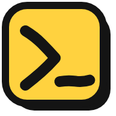

<div align="center">



# doodle-prompt

### 설명하지 말고, 그리세요.

**글보다 그림이 빠른 모든 생각을 위해**

[English](README.md) | 한국어

</div>

---

어떤 생각은 문장보다 모양으로 먼저 떠올라요. 두 갈래로 나뉘었다가 다시 합쳐지는 모델, 여러 갈래로 퍼졌다가 정제되고 다시 합쳐지는 파이프라인, 큐 하나에 워커 셋이 붙은 서비스 구조. 머릿속에는 보이는데 글로 쓰면 다섯 문단이 되고, 에이전트는 그래도 다른 걸 만들어요.

**doodle-prompt는 에이전트에게 펜을 쥐여 줘요.** 내가 그리면 Claude가 스케치를 읽고, 정리하고, 빠진 곳을 채우고, 질문도 그림 옆에 그려서 해요. 두세 번 주고받으면 둘이 같은 그림을 보게 돼요. 구현 요청은 그다음이에요.

```
나:      ▭ → ▭ ⇉ ▭ ▭ → ▭             (상자들, 갈라졌다 합쳐지는 화살표)
Claude:  [원본 로그] → [정제] ⇉ [사용자 피처] [아이템 피처] → [조인] → [ ? ]
         "조인 결과는 학습에 쓰나요, 일일 리포트에 쓰나요?"
나:      (? 옆에 "학습"이라고 쓰고, 타워 두 개짜리 상자를 그림)
Claude:  … → [조인] → [투 타워 모델] → [랭킹 손실]   ✓ 구현 준비 완료
```

## 🧠 머릿속에 있는 건 뭐든 그려요

- **ML 모델**: 레이어, 분기, 스킵 연결, 손실이 붙는 위치.
- **데이터 파이프라인**: 데이터 소스, 변환 단계, 갈라지고 합쳐지는 지점, 어디서 언제 돌릴지.
- **시스템 구조**: 서비스, 큐, 데이터베이스, 누가 누구를 호출하는지.
- **알고리즘과 상태 머신**: 어차피 화이트보드에 그렸을 상자와 화살표.
- **UI와 화면 흐름**: 화면, 레이아웃, 클릭하면 일어나는 일.

동료에게 설명하려고 화이트보드 앞에 설 만한 내용이라면, 여기에 그리면 돼요.

## ✏️ 어디에든 그려요

**오버레이 모드**는 화면 전체를 캔버스로 만들어요. 손실 곡선에서 튀는 구간에 동그라미를 치고, 노트북 출력에서 이상한 열을 가리키고, 파이프라인 다이어그램이나 실행 중인 앱 위에 빠진 단계를 바로 그려 보세요. 보내면 Claude는 그린 선과 **그 아래 화면**을 함께 봐요.

- **클릭 통과**: `Esc`를 누르면 그린 건 화면에 남고 클릭은 아래 앱으로 가요.
- **접어 두기**: 오버레이를 떠 있는 아이콘 하나로 접을 수 있어요. 아이콘을 어디로든, 다른 모니터로도 끌어 옮기면 오버레이가 따라가요.
- **창 모드**: 터미널 옆 일반 캔버스 창이 편하다면 버튼 하나로 바꿀 수 있어요.

## 🤝 한 번 던지고 끝나지 않아요

- **Claude도 그려요.** Claude의 선은 보라색이라 누가 그렸는지 바로 알 수 있어요.
- **추측하기 전에 물어봐요.** Claude가 이해한 내용을 한 문장으로 확인하면, **Yes** 또는 **Not quite** 버튼 하나로 답하면 돼요.
- **그리는 동안에도 대화할 수 있어요.** Claude는 백그라운드에서 기다리니까 채팅이 막히지 않아요.
- **무엇이든 되돌릴 수 있어요.** 내가 그린 것도, Claude가 그린 것도 실행 취소돼요.

## 🎨 제대로 된 그리기 도구

펜, 도형, 화살표, 텍스트, 페인트 통, 그림판 방식의 선택(이동, 크기 조절, 뒤집기, 회전, 복제), 순서 변경과 숨기기와 이름 변경이 되는 레이어, 스크린샷 붙여 넣기까지 있어요. 모든 도구에 한 글자 단축키가 있어요.

## 🚀 시작하기

**1. 플러그인 설치** (Claude Code에서):

```
/plugin marketplace add JuwonHwang/doodle-prompt
/plugin install doodle-prompt@doodle-prompt
```

**2. 앱 설치**: [최신 릴리스](https://github.com/JuwonHwang/doodle-prompt/releases/latest)에서 macOS는 `.dmg`, Windows는 `Setup .exe`를 받으세요.

**3. `/doodle` 입력** (또는 "그려서 보여줄게"). 이제 그리면 돼요.

> 앱 빌드에는 아직 코드 서명이 없어요. macOS에서는 처음 실행할 때 앱을 우클릭해 **열기**를 선택하고, Windows에서는 SmartScreen에서 **실행**을 선택해 주세요. 플러그인에는 Node.js 18 이상이 필요해요.

### 다른 에이전트를 쓴다면

캔버스는 일반 CLI로 조작하니까, 셸 명령을 실행할 수 있는 에이전트라면 쓸 수 있어요.

```
npx doodle-prompt start   # 캔버스 열기
npx doodle-prompt wait    # 사용자가 Send를 누를 때까지 대기
npx doodle-prompt draw -  # 표준 입력으로 받은 JSON 도형 그리기
```

`npx doodle-prompt help`로 전체 명령을 볼 수 있어요. 주고받는 절차와 도형 형식은 [`skills/doodle/SKILL.md`](skills/doodle/SKILL.md)에 있어요. 지금은 Claude Code에서만 테스트했어요.

## 🔒 모든 게 내 컴퓨터 안에서

- 캔버스 서버는 `127.0.0.1`에서만 실행돼요(포트 4777, 사용 중이면 빈 포트). Claude가 평소에 보는 것 외에는 밖으로 나가는 게 없어요.
- 스케치는 프로젝트의 `.doodle/` 폴더에 저장되고, 이 폴더는 자체 `.gitignore`로 git에서 빠져요.
- macOS에서는 오버레이를 처음 열 때 화면 기록 권한을 요청해요. 이 권한이 있어야 Claude가 그림 아래 화면을 볼 수 있어요.

<details>
<summary><b>단축키</b></summary>

`V` 선택 · `S` 자유 선택 · `P` 펜 · `E` 지우개 · `T` 텍스트 · `R` 사각형 · `O` 원 · `A` 화살표 · `F` 채우기 · `L` 레이어 · `C` 채팅 패널 · `Ctrl/⌘ +`/`-`/`0` 확대·축소·화면 맞춤 · `Space`+드래그 이동 · `Delete` 선택 항목 삭제 · `Ctrl/⌘+Z` 실행 취소 · `Ctrl/⌘+Shift+Z` 다시 실행 · `Ctrl/⌘+C`/`X`/`V` 복사·잘라내기·붙여 넣기 · `Ctrl/⌘+Enter` 보내기 · `Esc` 오버레이 클릭 통과

</details>

<details>
<summary><b>소스에서 실행</b></summary>

`npm install`을 실행하면 플러그인의 `start`가 로컬 Electron으로 앱을 열어요. `npm run dist`는 설치 파일을 `dist/`에 만들어요. 다른 앱 빌드를 쓰려면 `DOODLE_APP`에 경로를 지정하세요.

```
src/doodle.mjs                    캔버스 서버 + CLI, 앱 실행
src/canvas.html                   캔버스 페이지
src/icon*.svg, icon-*.png         앱 아이콘
app/main.mjs                      데스크톱 앱 (Electron): 캔버스 창과 오버레이
app/preload.cjs                   캔버스 페이지가 앱에 요청할 수 있는 기능
.github/workflows/release.yml     v* 태그를 푸시하면 macOS, Windows 앱 빌드
package.json                      npm 패키지 (bin: doodle-prompt)와 앱 빌드 설정
.claude-plugin/                   Claude Code 플러그인 매니페스트와 마켓플레이스
skills/doodle/SKILL.md            Claude가 스케치를 주고받는 절차
```

</details>

## 💬 피드백

버그를 찾았거나 다른 에이전트 지원이 필요하면 [이슈](https://github.com/JuwonHwang/doodle-prompt/issues)를 남겨 주세요. PR은 받지 않지만 포크는 자유예요. 자세한 내용은 [CONTRIBUTING.md](CONTRIBUTING.md)를 봐 주세요.

## 라이선스

MIT
