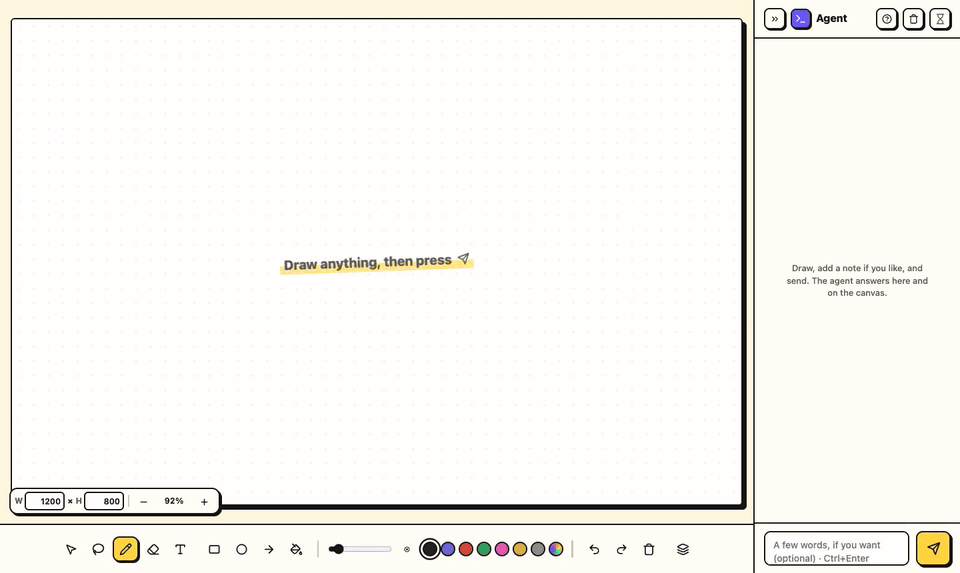
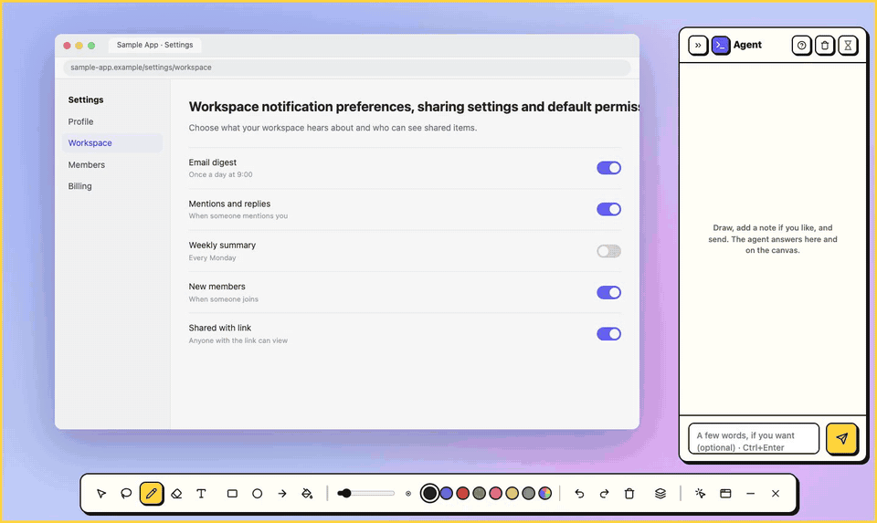

<div align="center">


# doodle-prompt

### Stop describing it. Draw it.

**For every idea that's easier to draw than to write.**

English | [한국어](README.ko.md)



</div>

---

Some ideas are shapes before they are sentences. A model with two branches that merge back. A pipeline that fans out, cleans, and joins. A service that talks to a queue that talks to three workers. You can see it, but writing it down takes five paragraphs, and the agent still builds something else.

**doodle-prompt gives your agent a pen.** You scribble. Claude reads the sketch, cleans it up, fills in the gaps, and draws its questions right next to yours. Two or three rounds later, you both have the same picture in mind, and *then* you ask it to build.

```
you:     ▭ → ▭ ⇉ ▭ ▭ → ▭             (boxes, a fork, a merge)
claude:  [raw logs] → [clean] ⇉ [user features] [item features] → [join] → [ ? ]
         "Does the join feed training, or a daily report?"
you:     (write "train" next to the ?, draw a box with two towers)
claude:  … → [join] → [two-tower model] → [ranking loss]   ✓ ready to build
```

## 🧠 Sketch whatever is in your head

- **ML models** — layers, branches, skip connections, where the loss attaches.
- **Data pipelines** — sources, transforms, fan-out and fan-in, what runs where and when.
- **System architecture** — services, queues, databases, who calls whom.
- **Algorithms and state machines** — the boxes and arrows you would draw on a whiteboard anyway.
- **UI and flows** — screens, layouts, what happens on click.

If you would reach for a whiteboard to explain it to a colleague, draw it here instead.

## ✏️ Draw on anything

**Overlay mode** turns your whole screen into the canvas. Circle the spike in your loss curve. Point at the column in a notebook output that looks wrong. Sketch the missing step right on top of your pipeline diagram, or the missing button on top of your app. When you send, Claude sees your strokes **and** the screen underneath them.



- **Click-through** — press `Esc` and your marks stay on screen while your clicks go to the app below.
- **Fold it away** — collapse the overlay into a floating icon. Drag it anywhere, even to your other monitor, and the overlay follows.
- **Window mode** — prefer a plain canvas next to your terminal? One click switches back.

## 🤝 A real back-and-forth, not a one-shot

- **Claude draws back** in violet, so you always know who drew what.
- **It asks before it guesses.** Claude says back what it understood, and you answer with one click: **Yes** or **Not quite**.
- **Keep talking while you draw.** Claude listens in the background, so your chat never blocks your sketch.
- **Undo anything**, yours or Claude's.

## 📸 Capture, then explain

Hit the camera button and whatever is on your screen lands on the canvas. Then mark it up: circle the outlier in a plot, box the stage that's slow in a profiler, arrow from the error to the line you suspect. Claude sees the capture and your marks together.

## 🎨 A real drawing tool

**Arrows that stick.** Start an arrow on a box and end it on another, and it stays connected when you move either one. Rearrange a pipeline without redrawing it. **Double-click any label** to edit it.

Pen, shapes, arrows, text, a paint bucket, Paint-style selection (move, scale, flip, rotate, duplicate), layers you can reorder, hide and rename, and paste-in screenshots. Every tool has a single-key shortcut.

## 🚀 Get started

**1. Install the plugin** in Claude Code:

```
/plugin marketplace add JuwonHwang/doodle-prompt
/plugin install doodle-prompt@doodle-prompt
```

**2. Install the app** from the [latest release](https://github.com/JuwonHwang/doodle-prompt/releases/latest): the `.dmg` for macOS, the `Setup .exe` for Windows.

**3. Say `/doodle`** (or just "let me draw it"). Start drawing. The first time, a five-step tour shows you around; the **?** in the chat panel plays it again.

> The app builds are not code-signed yet. On macOS, right-click the app → **Open** the first time; on Windows, choose **Run anyway** in SmartScreen. The plugin needs Node.js 18+.

### Using another agent?

The canvas is driven by a plain CLI, so any agent that can run shell commands can use it:

```
npx github:JuwonHwang/doodle-prompt start   # open the canvas
npx github:JuwonHwang/doodle-prompt wait    # block until the user presses Send
npx github:JuwonHwang/doodle-prompt draw -  # draw shapes from JSON on stdin
```

`npx github:JuwonHwang/doodle-prompt help` lists every command (pin a release with `#v0.2.0`), and [`skills/doodle/SKILL.md`](skills/doodle/SKILL.md) describes the loop and the shape format. Only Claude Code is tested today, and the Windows app has not been run on Windows yet.

## 🔒 Local by design

- The canvas server runs on `127.0.0.1` (port 4777, or a free one if taken). Nothing leaves your machine except what Claude normally sees.
- Sketches live in `.doodle/` in your project, and that folder git-ignores itself.
- On macOS, the overlay asks for Screen Recording permission the first time you open it. That is what lets Claude see the screen under your marks.

<details>
<summary><b>Keyboard shortcuts</b></summary>

`V` select · `S` free-form select · `P` pen · `E` eraser · `T` text · `R` rectangle · `O` ellipse · `A` arrow · `F` fill · `L` layers · `C` chat panel · `Ctrl/⌘ +`/`-`/`0` zoom in, out, fit · `Space`+drag pan · `Delete` remove selection · `Ctrl/⌘+Z` undo · `Ctrl/⌘+Shift+Z` redo · `Ctrl/⌘+C`/`X`/`V` copy, cut, paste · `Ctrl/⌘+Enter` send · `Esc` click through (overlay)

</details>

<details>
<summary><b>Run from source</b></summary>

`npm install`, and the plugin's `start` uses the local Electron automatically. `node scripts/demo.mjs` and `node scripts/demo-overlay.mjs` re-record the demo videos into `docs/` (needs Node 22+, Google Chrome and ffmpeg). `npm run dist` builds the installers into `dist/`. `DOODLE_APP` points `start` at another build of the app.

```
src/doodle.mjs                    canvas server + CLI, launches the app
src/canvas.html                   the canvas
src/icon*.svg, icon-*.png         app icon
app/main.mjs                      desktop app (Electron): the canvas window and the overlay
app/preload.cjs                   what the canvas page may ask of the app
.github/workflows/release.yml     builds the macOS and Windows app for a v* tag
package.json                      npm package (bin: doodle-prompt) and app build config
.claude-plugin/                   Claude Code plugin manifest and marketplace
skills/doodle/SKILL.md            how Claude runs the sketch loop
```

</details>

## 💬 Feedback

Found a bug or want support for another agent? [Open an issue](https://github.com/JuwonHwang/doodle-prompt/issues). Pull requests are not accepted, but forks are welcome. See [CONTRIBUTING.md](CONTRIBUTING.md).

## License

MIT
